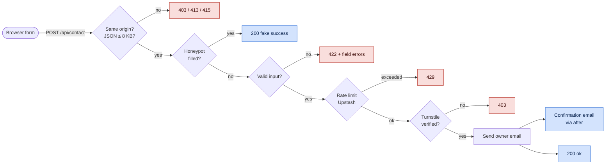

<div align="center">


### Full stack developer building web, mobile and AI products.

A fast, accessible portfolio with a built-in chat assistant<br />and a spam-protected contact form.

[](https://srinathnulidonda.vercel.app)


[**Features**](#-features) &nbsp;•&nbsp;
[**Tech stack**](#-tech-stack) &nbsp;•&nbsp;
[**Architecture**](#-architecture) &nbsp;•&nbsp;
[**Run locally**](#-run-locally) &nbsp;•&nbsp;
[**Structure**](#-project-structure) &nbsp;•&nbsp;
[**Customize**](#-customize)

</div>

## ✨ Features

<table>
  <tr>
    <td width="50%" valign="top">

### 🎨 Design and UX

- Light and dark themes with a no-flash inline script
- Material-inspired color tokens
- Typed role animation (respects reduced motion)
- Project filters and full-screen previews on native `<dialog>`
- Scroll-spy navigation and a mobile menu

</td>
    <td width="50%" valign="top">

### 💬 Chat assistant

- Rule-based "Ask Srinath" widget: no API, no cost
- Understands projects, skills, hiring, contact and resume
- Quick replies and persisted history
- Keyboard and screen reader friendly

</td>
  </tr>
  <tr>
    <td width="50%" valign="top">

### 📬 Contact form

- Shared client and server validation
- Cloudflare Turnstile and a honeypot field
- Same-origin check and streamed 8 KB body cap
- Upstash Redis rate limiting
- Email through EmailJS, with an optional confirmation

</td>
    <td width="50%" valign="top">

### 🔎 SEO and privacy

- Metadata API, Open Graph and Twitter images
- `sitemap.xml`, `robots.txt` and a JSON-LD graph
- Consent-gated Google Tag Manager
- Security headers and a Content-Security-Policy

</td>
  </tr>
</table>

> [!NOTE]
> **♿ Accessibility** &nbsp;·&nbsp; Skip link, semantic landmarks, visible focus states, labelled form errors with focus handling, `prefers-reduced-motion` support, and touch-friendly hit targets.

## 🧰 Tech stack

| Layer | Tools |
| :-- | :-- |
| **Framework** | Next.js (App Router, Cache Components, `after()`) |
| **UI** | React · TypeScript · Tailwind CSS v4 · Lucide icons |
| **Fonts** | Roboto via `next/font` |
| **Email** | EmailJS REST API (server-side) |
| **Bot protection** | Cloudflare Turnstile |
| **Rate limiting** | Upstash Redis (in-memory fallback) |
| **Analytics** | Google Tag Manager (opt-in) |
| **Hosting** | Vercel |

## 🏗 Architecture

### Contact request flow



### Chat engine

`getChatReply()` in `data/utils.ts` normalizes the input and matches it in a fixed priority order:

```text
button labels → skill groups → greetings → thanks → resume
  → project names → skill questions → hiring → contact
  → skills → projects → about → location → fallback
```

Projects and skills are read from the same data files as the rest of the site, so the bot always stays in sync.

## 🚀 Run locally

```bash
git clone https://github.com/<your-username>/<your-repo>.git
cd <your-repo>
npm install
cp .env.example .env.local
npm run dev
```

Open <http://localhost:3000>.

<details>
<summary><b>🔐 Environment variables</b></summary>

<br />

| Variable | Need | Purpose |
| :-- | :--: | :-- |
| `EMAILJS_SERVICE_ID` | ✅ | EmailJS service |
| `EMAILJS_OWNER_TEMPLATE_ID` | ✅ | Notification template |
| `EMAILJS_PUBLIC_KEY` | ✅ | EmailJS public key |
| `EMAILJS_PRIVATE_KEY` | ✅ | EmailJS private key |
| `EMAILJS_CONFIRM_TEMPLATE_ID` | ➖ | Sender confirmation template |
| `TURNSTILE_SECRET` | 🚀 | Turnstile secret |
| `NEXT_PUBLIC_TURNSTILE_SITE_KEY` | 🚀 | Turnstile site key |
| `UPSTASH_REDIS_REST_URL` | 👍 | Shared rate limiting |
| `UPSTASH_REDIS_REST_TOKEN` | 👍 | Shared rate limiting |
| `BING_SITE_VERIFICATION` | ➖ | Bing Webmaster token |

<sub>✅ Required &nbsp;·&nbsp; 🚀 Required in production &nbsp;·&nbsp; 👍 Recommended &nbsp;·&nbsp; ➖ Optional</sub>

> [!IMPORTANT]
> Set both Turnstile variables or neither. The build fails on a mismatch.

> [!TIP]
> `NEXT_PUBLIC_*` values are inlined at build time, so redeploy after changing them.

</details>

## 📁 Project structure

<details>
<summary><b>Expand tree</b></summary>

```text
app/
├── api/contact/route.ts      Contact endpoint
├── layout.tsx                Metadata, fonts, theme script
├── page.tsx                  Home page
├── error.tsx                 Route error boundary
├── global-error.tsx          Root error boundary
├── not-found.tsx             404 page
├── opengraph-image.tsx       Generated OG image
├── twitter-image.tsx         Reuses the OG image
├── robots.ts · sitemap.ts    SEO files
└── globals.css               Tailwind v4 tokens and utilities

components/
├── chat/chat-widget.tsx
├── layout/                   nav · footer · shell · theme-toggle · analytics
├── sections/                 hero · about · projects · contact
├── ui/turnstile.tsx
└── json-ld.tsx

data/
├── constant.ts               Site info, nav, socials, skills, chat copy
├── projects.ts               Projects (feeds the grid, chat and JSON-LD)
├── security-headers.ts       Security headers and CSP
├── theme-script.ts           No-flash theme script
├── types.ts
├── utils.ts                  cn() and the chat reply engine
└── validate.ts               Shared contact validation

assets/                       Profile and project screenshots
public/                       logo · chat avatar · favicon · resume.pdf
```

</details>

## 🎛 Customize

| To change | Edit |
| :-- | :-- |
| Name, role, URLs, email, GTM ID | `data/constant.ts` → `SITE` |
| Socials, skills, services, typed roles | `data/constant.ts` |
| Projects | `data/projects.ts` (images go in `assets/projects/`) |
| Chat greeting and suggestions | `data/constant.ts` → `CHAT` |
| Chat keywords and behavior | `data/utils.ts` |
| Colors and themes | `app/globals.css` |
| Resume | `public/resume.pdf` |
| OG image | `app/opengraph-image.tsx` |

<details>
<summary><b>➕ Adding a project</b></summary>

<br />

Add an entry to `PROJECTS` in `data/projects.ts`:

```ts
{
  id: "my-project",
  title: "My Project",
  aliases: ["my project"],        // words the chat bot recognizes
  category: "Full stack web app",
  filters: ["web"],               // "web" | "mobile" | "ml"
  description: "What it does.",
  stack: ["Next.js", "TypeScript"],
  image,                          // imported from assets/projects/
  alt: "Describe the screenshot",
  live: "https://example.com",
  code: null,                     // or a GitHub URL
}
```

It then shows up in the grid, the filters, the chat bot and the JSON-LD.

</details>

## 📄 License

Copyright © Srinath Nulidonda. All rights reserved.<br />
The source is public for reference. Please don't reuse the personal content, photos, screenshots or branding.

<!-- Prefer open source? Replace this section with an MIT license and add a LICENSE file. -->

---

<div align="center">

<br />

**[🌐 Visit the live site](https://srinathnulidonda.vercel.app)** &nbsp;·&nbsp; **[✉️ Get in touch](mailto:srinathnulidonda@gmail.com)**

<br />

</div>